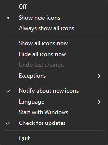

#  TrayReveal

[English](#english) · [Deutsch](#deutsch)

## English

A tiny tray app for Windows 11 that keeps your notification area icons visible.
Windows 11 hides every new tray icon behind the `^` overflow menu and no longer offers the old "Always show all icons" checkbox. TrayReveal brings that convenience back: it watches the icon list of the current user and shows new icons right away – or all of them, if you prefer.

### Installation
1. Download `TrayReveal-<version>-windows-x64.zip` from [Releases](../../releases).
2. Extract it, e.g. to `C:\Program Files\TrayReveal` (needs administrator rights once) or to any folder of your choice. Keep the `lang` folder next to `TrayReveal.exe`.
3. Start `TrayReveal.exe`. The program is not signed, so SmartScreen may warn on the first start: "More info" → "Run anyway".

Each archive has a `.sha256` file to verify the download, and the release notes link a VirusTotal scan.

### Usage
Start `TrayReveal.exe`. On the first start it only remembers the icons that already exist and changes nothing. Right-click (or left-click) its tray icon for the menu:



- **Off** – watch only, change nothing
- **Show new icons** (default) – every new icon is shown once; if you hide it later in the Windows Settings, it stays hidden
- **Always show all icons** – keeps every icon visible, except the exceptions
- **Show all icons now / Hide all icons now** – one-time actions; hiding is not available while all icons are always shown
- **Exceptions** – lists the apps with their icons; apps marked with a red cross always stay hidden, clicking them again shows them again (except in Off mode)
- **Notify about new icons**, **Language**, **Start with Windows**, **Quit**

The menu follows the light or dark mode of the taskbar.

When an app updates into a new versioned folder (for example `app-1.2.3` or a Microsoft Store package), Windows creates a new hidden entry for it. TrayReveal recognizes the same app and keeps your previous choice. Exceptions apply to all versions of an app. If several older versions exist, the one changed last counts.

Entries whose program has been missing for three days in a row are removed from the Windows tray settings, so old versions do not pile up. In Off mode nothing is removed.

`TrayReveal.exe --once` applies the current settings once without a tray icon and exits, e.g. for the Task Scheduler.

### Languages
TrayReveal comes in 51 languages, including German dialects and a few fun languages; [LANGUAGES.md](LANGUAGES.md) lists all codes. With **Automatic**, it follows the Windows display language and falls back to English.

The translations were generated by Claude (AI). Most of them have not been checked by a native speaker yet; [LANGUAGES.md](LANGUAGES.md) and the header of each file show which ones have. If you notice a mistake or know a better wording, please open an [issue](../../issues) or a pull request. Reviewers are credited with their GitHub name in the language file and in [LANGUAGES.md](LANGUAGES.md), if they agree.

The texts are plain text files named after the language code, e.g. `de.lang` or `pt-BR.lang`, with one `key = text` per line. To add a language, copy [`lang/en.lang`](lang/en.lang), translate the texts after the `=` and keep the keys and placeholders such as `{name}`. Missing texts are taken from the fallback language (`language.fallback`), otherwise from English.

Language files are read from the `lang` folder next to the program and from `%APPDATA%\TrayReveal\lang`. The second folder needs no administrator rights and its texts take priority, so you can add a language or change single texts there.

### How it works
Windows stores the visibility of each tray icon per user under `HKCU\Control Panel\NotifyIconSettings`, one subkey per icon. The value `IsPromoted` decides whether the icon is shown on the taskbar (`1`) or hidden in the overflow menu (`0`); for icons that were never shown, the value is missing.
TrayReveal waits for changes to this key (no polling), sets or creates `IsPromoted` according to the chosen mode and leaves everything else untouched. It is the same value the Windows Settings toggle writes, so you can still change single icons there.

- Runs as a standard user, no administrator rights, writes only to `HKCU`
- No window, only a tray icon with a context menu
- No network access, no telemetry
- Settings are stored in the registry under `HKCU\Software\TrayReveal`

The registry key is not documented by Microsoft and may change with future Windows updates. If its layout changes, TrayReveal does nothing instead of guessing.

### Building
TrayReveal is written in Rust and only depends on the official Windows API bindings.

```
cargo build --release
```

For tests, `cargo run --example tray_probe -- "Probe" 60` shows a test tray icon for 60 seconds. Copied into folders such as `app-1.0.0` and `app-1.0.1`, it simulates app updates.

A release is created automatically when a new version in `Cargo.toml` reaches `main`.

### License
[MIT](LICENSE) – not affiliated with or endorsed by Microsoft. Windows is a trademark of the Microsoft group of companies.

## Deutsch

Eine kleine Tray-App für Windows 11, die die Symbole im Infobereich sichtbar hält.
Windows 11 versteckt jedes neue Tray-Icon hinter dem `^`-Überlaufmenü und bietet das frühere Häkchen „Immer alle Symbole anzeigen“ nicht mehr an. TrayReveal bringt diesen Komfort zurück: Es beobachtet die Icon-Liste des aktuellen Benutzers und blendet neue Icons sofort ein – oder auf Wunsch alle.

### Installation
1. `TrayReveal-<Version>-windows-x64.zip` unter [Releases](../../releases) herunterladen.
2. Entpacken, z. B. nach `C:\Program Files\TrayReveal` (braucht einmalig Administratorrechte) oder in einen beliebigen Ordner. Der Ordner `lang` bleibt neben `TrayReveal.exe`.
3. `TrayReveal.exe` starten. Das Programm ist nicht signiert, deshalb warnt SmartScreen beim ersten Start eventuell: „Weitere Informationen“ → „Trotzdem ausführen“.

Zu jedem Archiv gibt es eine `.sha256`-Datei zum Prüfen des Downloads, und die Release-Notizen verlinken einen VirusTotal-Scan.

### Bedienung
`TrayReveal.exe` starten. Beim ersten Start merkt es sich nur die bereits vorhandenen Icons und ändert nichts. Ein Rechtsklick (oder Linksklick) auf das Tray-Icon öffnet das Menü:


- **Aus** – nur beobachten, nichts ändern
- **Neue Icons einblenden** (Standard) – jedes neue Icon wird einmal eingeblendet; blendest du es später in den Windows-Einstellungen aus, bleibt es ausgeblendet
- **Immer alle Icons einblenden** – hält alle Icons sichtbar, außer den Ausnahmen
- **Jetzt alle Icons einblenden / ausblenden** – einmalige Aktionen; Ausblenden ist nicht verfügbar, solange immer alle Icons eingeblendet werden
- **Ausnahmen** – listet die Apps mit ihren Icons; mit rotem X markierte Apps bleiben immer ausgeblendet, ein erneuter Klick blendet sie wieder ein (außer im Modus „Aus“)
- **Hinweis bei neuen Icons**, **Sprache**, **Mit Windows starten**, **Beenden**

Das Menü folgt dem hellen oder dunklen Modus der Taskleiste.

Wenn sich eine App in einen neuen Ordner mit Versionsnummer aktualisiert (zum Beispiel `app-1.2.3` oder ein Microsoft-Store-Paket), legt Windows dafür einen neuen, ausgeblendeten Eintrag an. TrayReveal erkennt die gleiche App und übernimmt deine bisherige Wahl. Ausnahmen gelten für alle Versionen einer App. Gibt es mehrere ältere Versionen, zählt die zuletzt geänderte.

Einträge, deren Programm drei Tage am Stück fehlt, werden aus den Tray-Einstellungen von Windows entfernt, damit sich alte Versionen nicht ansammeln. Im Modus „Aus“ wird nichts entfernt.

`TrayReveal.exe --once` wendet die aktuellen Einstellungen einmal ohne Tray-Icon an und beendet sich, etwa für die Aufgabenplanung.

### Sprachen
TrayReveal gibt es in 51 Sprachen, darunter deutsche Dialekte und einige Spaßsprachen; [LANGUAGES.md](LANGUAGES.md) listet alle Codes. Mit **Automatisch** folgt es der Anzeigesprache von Windows und fällt sonst auf Englisch zurück.

Die Übersetzungen wurden von Claude (KI) erzeugt. Die meisten hat noch keine Muttersprachlerin und kein Muttersprachler geprüft; welche geprüft sind, zeigen [LANGUAGES.md](LANGUAGES.md) und der Kopf jeder Datei. Wenn dir ein Fehler auffällt oder du eine bessere Formulierung kennst, eröffne gern ein [Issue](../../issues) oder einen Pull Request. Mit Einverständnis wird die prüfende Person mit ihrem GitHub-Namen in der Sprachdatei und in [LANGUAGES.md](LANGUAGES.md) genannt.

Die Texte liegen in einfachen Textdateien, benannt nach dem Sprachcode, z. B. `de.lang` oder `pt-BR.lang`, mit einem `Schlüssel = Text` pro Zeile. Für eine neue Sprache kopierst du [`lang/en.lang`](lang/en.lang), übersetzt die Texte nach dem `=` und lässt die Schlüssel und Platzhalter wie `{name}` unverändert. Fehlende Texte kommen aus der Rückfallsprache (`language.fallback`), sonst aus Englisch.

Sprachdateien werden aus dem Ordner `lang` neben dem Programm und aus `%APPDATA%\TrayReveal\lang` gelesen. Der zweite Ordner braucht keine Administratorrechte und seine Texte haben Vorrang, dort kannst du also eine Sprache ergänzen oder einzelne Texte ändern.

### Funktionsweise
Windows speichert die Sichtbarkeit jedes Tray-Icons pro Benutzer unter `HKCU\Control Panel\NotifyIconSettings`, ein Unterschlüssel pro Icon. Der Wert `IsPromoted` legt fest, ob das Icon in der Taskleiste angezeigt (`1`) oder im Überlaufmenü versteckt wird (`0`); bei Icons, die noch nie angezeigt wurden, fehlt der Wert.
TrayReveal wartet auf Änderungen an diesem Schlüssel (ohne regelmäßiges Abfragen), setzt oder erzeugt `IsPromoted` je nach gewähltem Modus und lässt alles andere unverändert. Es ist derselbe Wert, den der Schalter in den Windows-Einstellungen schreibt, einzelne Icons lassen sich dort also weiterhin ändern.

- Läuft als Standardbenutzer, ohne Administratorrechte, schreibt nur in `HKCU`
- Kein Fenster, nur ein Tray-Icon mit Kontextmenü
- Kein Netzwerkzugriff, keine Telemetrie
- Einstellungen liegen in der Registry unter `HKCU\Software\TrayReveal`

Der Registry-Schlüssel ist von Microsoft nicht dokumentiert und kann sich mit künftigen Windows-Updates ändern. Ändert sich sein Aufbau, tut TrayReveal nichts, statt zu raten.

### Bauen
TrayReveal ist in Rust geschrieben und hängt nur von den offiziellen Windows-API-Bindings ab.

```
cargo build --release
```

Für Tests zeigt `cargo run --example tray_probe -- "Probe" 60` für 60 Sekunden ein Test-Tray-Icon an. In Ordner wie `app-1.0.0` und `app-1.0.1` kopiert, simuliert es App-Updates.

Ein Release entsteht automatisch, sobald eine neue Version in `Cargo.toml` auf `main` landet.

### Lizenz
[MIT](LICENSE) – keine Verbindung zu Microsoft und nicht von Microsoft unterstützt. Windows ist eine Marke der Microsoft-Unternehmensgruppe.
